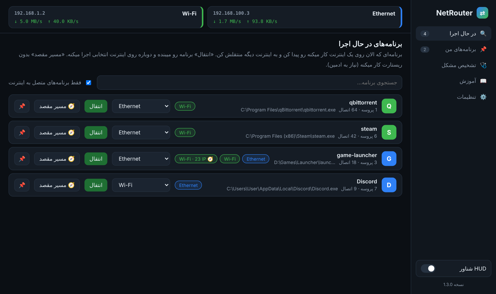

# NetRouter

**انتخاب کن هر برنامه از کدام اینترنت استفاده کند.**
استیم و دانلودها روی یک اینترنت، بازی آنلاین روی اینترنت دیگر.

[**⬇ دانلود برای ویندوز**](../../releases/latest) · [راهنما](docs/GUIDE.fa.md) · [English](README.md) · [گزارش مشکل](../../issues/new/choose)

## NetRouter چیست؟

اگر کامپیوترت همزمان به دو اینترنت وصل است (مثلاً فیبر با کابل شبکه و ADSL با وای‌فای)، ویندوز تقریباً همه‌چیز را از یکی از آن‌ها می‌فرستد. NetRouter به تو اجازه می‌دهد **خودت** برای هر برنامه تصمیم بگیری.

نمونه‌ی رایج: اینترنت سریع را پیش‌فرض ویندوز نگه می‌داری تا بازی‌ها با پینگ پایین از آن بروند، و استیم، لانچر بازی‌ها و دانلودرها را به اینترنت دوم می‌بری تا آپدیت‌های حجیم بازی‌ات را قفل نکنند.

## امکانات

- **نمای زنده:** هر اینترنت با آی‌پی و سرعت لحظه‌ای دانلود و آپلود.
- **اسکن برنامه‌های در حال اجرا:** برنامه‌هایی که الان آنلاین هستند و اینترنتی که استفاده می‌کنند را خودکار نشان می‌دهد.
- **انتقال:** برنامه را روی اینترنت دلخواه دوباره اجرا می‌کند و **بررسی می‌کند** واقعاً روی آن اینترنت کار می‌کند. اگر نشد، صادقانه می‌گوید.
- **🧭 مسیر مقصد:** برای لانچرهایی که دانلود را در پروسه‌ی جدا انجام می‌دهند. بدون ریستارت، همه‌ی اتصال‌های برنامه را از اینترنت انتخابی می‌فرستد.
- **تشخیص مشکل:** پیدا می‌کند چرا برنامه حرف تو را گوش نمی‌کند (مودم‌های هم‌رنج، پروکسی یا VPN، تنظیمات ویندوز) و گزارش قابل کپی می‌دهد.
- **برنامه‌های من:** برنامه‌ها را با اینترنت ثابت ذخیره کن و با یک کلیک اجرا کن.
- **HUD شناور:** پنجره‌ی کوچک همیشه-روی-صفحه با سرعت لحظه‌ای هر اینترنت.
- اجرا در سینی ویندوز و شروع همراه ویندوز.
- **راهنمای داخل برنامه** با رفع مشکل قدم‌به‌قدم. فارسی و انگلیسی.

## نصب

1. فایل `NetRouter Setup <نسخه>.exe` را از [آخرین نسخه](../../releases/latest) دانلود کن.
2. اجرایش کن. چون فایل نصبی امضای دیجیتال ندارد، ویندوز ممکن است هشدار SmartScreen بدهد: روی **More info** و بعد **Run anyway** بزن. می‌توانی فایل را با هش SHA256 که در توضیحات نسخه آمده بررسی کنی (`certutil -hashfile "NetRouter Setup 1.3.0.exe" SHA256`).
3. NetRouter را باز کن و دکمه‌ی **نصب خودکار** را بزن تا ForceBindIP نصب شود.

**نیازمندی‌ها:** ویندوز ۱۰ یا ۱۱ (۶۴ بیتی) و دو اینترنت فعال.

## شروع سریع

1. تب **در حال اجرا** را باز کن و برنامه را پیدا کن.
2. اینترنت را از منوی کشویی انتخاب کن و **انتقال** را بزن.
3. بعد از چند ثانیه NetRouter بررسی می‌کند و نتیجه را می‌گوید.

اگر برنامه هنوز روی اینترنت قبلی بود، تب **تشخیص مشکل** را باز کن. [راهنما](docs/GUIDE.fa.md) همه‌ی حالت‌ها را توضیح داده است.

## طرز کار

- **انتقال** از ابزار [ForceBindIP](https://r1ch.net/projects/forcebindip) ساخته‌ی R1CH استفاده می‌کند تا برنامه را به کارت شبکه‌ی انتخابی وصل کند. NetRouter خودش ForceBindIP را همراه ندارد و فقط وقتی دکمه‌ی نصب را بزنی از سایت رسمی دانلودش می‌کند.
- **مسیر مقصد** برای آدرس سرورهایی که برنامه به آن‌ها وصل است، مسیر موقت (IPv4 و TCP) می‌سازد. دسترسی ادمین می‌خواهد، تزریقی ندارد و با بسته شدن NetRouter مسیرها پاک می‌شوند.

## حریم خصوصی و ایمنی

- بدون حساب کاربری، بدون ارسال آمار، بدون تبلیغ و بدون به‌روزرسانی خودکار.
- تنظیماتت فقط روی کامپیوتر خودت و در `%APPDATA%\NetRouter` می‌ماند.
- تنها درخواست‌های اینترنتی برنامه همانی است که خودت شروع می‌کنی: دانلود ForceBindIP از r1ch.net و پرسیدن آی‌پی عمومی در **تشخیص مشکل** (api.ipify.org و icanhazip.com و ifconfig.me).
- برنامه برای خواندن اتصال‌ها و پروسه‌ها در پس‌زمینه PowerShell اجرا می‌کند. **انتقال** برنامه‌ی انتخابی را می‌بندد، پس کارت را قبلش ذخیره کن.
- **با بازی‌هایی که آنتی‌چیت دارند (Valorant، Easy Anti-Cheat، BattlEye و مشابه) استفاده نکن.** تزریق ممکن است اشتباهاً تقلب حساب شود. بازی را روی اینترنت پیش‌فرض بگذار و فقط لانچر یا دانلودرش را منتقل کن.
- مرورگرهای کرومیومی (Chrome، Edge و مشابه) با **انتقال** کار نمی‌کنند.

## پشتیبانی

مشکلی داری؟ [یک Issue باز کن](../../issues/new/choose) و گزارش **تشخیص مشکل ← کپی گزارش** را بچسبان. لطفاً اول [راهنما](docs/GUIDE.fa.md) را بخوان، بیشتر مشکلات آنجا حل می‌شوند.

## مجوز

استفاده برای مصارف شخصی و تجاری رایگان است. [LICENSE](LICENSE) را ببین. این مخزن فقط شامل فایل‌های دانلود و مستندات است و کد منبع عمومی نیست.

NetRouter پروژه‌ی مستقل است و هیچ ارتباطی با Valve، Steam یا ناشران بازی ندارد. نام‌ها و علامت‌های تجاری متعلق به صاحبانشان است.

