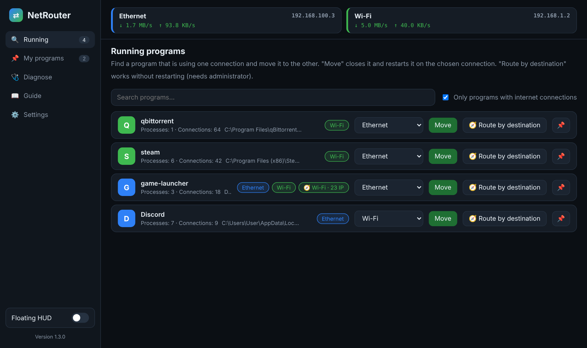
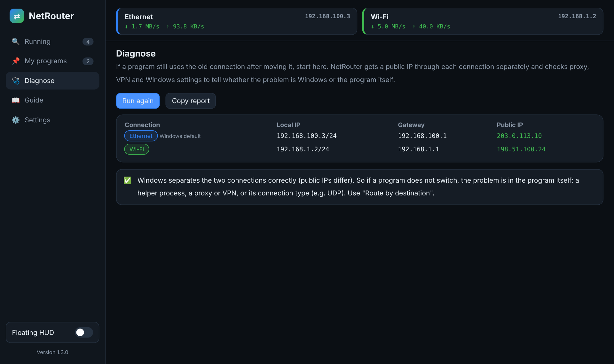
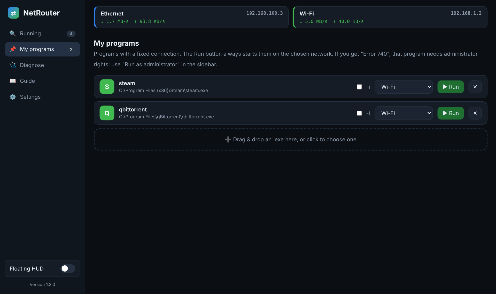

# NetRouter

**Choose which internet connection each program uses.**
Run Steam and downloads on one connection, play online on the other.

[**⬇ Download for Windows**](../../releases/latest) · [Guide](docs/GUIDE.md) · [راهنمای فارسی](README.fa.md) · [Report a problem](../../issues/new/choose)

## What is it?

If your PC is connected to two networks at the same time (for example fiber over Ethernet and ADSL over Wi-Fi), Windows sends almost everything through just one of them. NetRouter lets **you** decide, program by program.

A typical setup: keep your fast connection as the Windows default so games use it with low ping, and send Steam, game launchers and download managers through the second connection so a big update never lags your match.

## Features

- **Live overview:** see every connection with its IP and real-time download and upload speed.
- **Running programs scan:** automatically lists the programs that are online right now and which connection each one uses.
- **Move:** restart a program on the connection you pick, then **verify** that it really uses it. NetRouter tells you honestly if it did not work.
- **🧭 Route by destination:** for launchers that download in a separate process. Sends all of a program's connections through the chosen network without restarting it.
- **Diagnose:** finds out why a program does not follow your choice (same-subnet modems, proxy or VPN, Windows settings) and gives a copyable report.
- **My programs:** save programs with a fixed connection and start them in one click.
- **Floating HUD:** a small always-on-top overlay with live speed per connection.
- Runs in the system tray and can start with Windows.
- Built-in **guide** with step-by-step fixes. English and Persian (فارسی).

## Screenshots

| Diagnose | My programs |
|---|---|
|  |  |

## Install

1. Download `NetRouter Setup <version>.exe` from the [latest release](../../releases/latest).
2. Run it. Windows may show a SmartScreen warning because the installer is not code-signed: click **More info → Run anyway**. You can check the file against the SHA256 hash published in the release notes (`certutil -hashfile "NetRouter Setup 1.3.0.exe" SHA256`).
3. Open NetRouter and press **Install automatically** to get ForceBindIP (see below).

**Requirements:** Windows 10 or 11 (64-bit) and two active network connections.

## Quick start

1. Open the **Running** tab and find your program.
2. Pick a connection in the dropdown and press **Move**.
3. NetRouter checks after a few seconds and tells you whether it worked.

If a program still uses the old connection, open the **Diagnose** tab. The [guide](docs/GUIDE.md) explains every case.

## How it works

- **Move** uses [ForceBindIP](https://r1ch.net/projects/forcebindip) by R1CH to start the program bound to the chosen network adapter. NetRouter does not include ForceBindIP: it downloads it from the official site only when you press the install button.
- **Route by destination** adds temporary host routes (IPv4, TCP) for the server addresses a program is connected to. It needs administrator rights, does no injection, and removes its routes when NetRouter closes.

## Privacy and safety

- No account, no telemetry, no ads, no automatic updates.
- Your settings stay on your PC in `%APPDATA%\NetRouter`.
- The only internet requests NetRouter makes are the ones you trigger: downloading ForceBindIP from r1ch.net, and the public-IP lookups of **Diagnose** (api.ipify.org, icanhazip.com, ifconfig.me).
- It runs PowerShell in the background to read connections and processes. **Move** closes the program you pick; save your work first.
- **Do not use it with games protected by anti-cheat** (Valorant, Easy Anti-Cheat, BattlEye and similar). Injection can be mistaken for cheating. Keep the game on the default connection and move only its launcher or downloader.
- Chromium browsers (Chrome, Edge and similar) are not supported by **Move**.

## Support

Something not working? [Open an issue](../../issues/new/choose) and paste the report from **Diagnose → Copy report**. Please read the [guide](docs/GUIDE.md) first, it solves most cases.

## License

Free to use for personal and commercial purposes. See [LICENSE](LICENSE). This repository contains downloads and documentation only; the source code is not public.

NetRouter is an independent project and is not affiliated with Valve, Steam or any game publisher. Trademarks belong to their owners.
